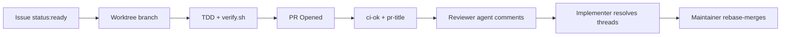

# Contributing to botifil

We use an agent-assisted workflow where human maintainers and autonomous agents collaborate via pull requests.

## Development Lifecycle



## Setup & Verification

Initialize toolchain and run verification:
```bash
mise install
./scripts/verify.sh
```

Maintainers bootstrap labels and repository settings via:
```bash
./scripts/gh-bootstrap.sh
```

## Labels

- `type:*`: `type:feat`, `type:fix`, `type:docs`, `type:chore`, `type:refactor`, `type:test`, `type:perf`.
- `area:*`: `area:bot`, `area:ci`, `area:docs`, `area:agents`.
- `status:*`: `status:needs-spec`, `status:ready`, `status:in-progress`, `status:blocked`, `status:needs-human`.
- `size:*`: `size:S`, `size:M`, `size:L` (keep PRs small and focused on one logical scope).

## Review & Merge Policy

- PRs require one logical scope per PR (small and focused, no arbitrary LoC limit) and all CI checks (`ci-ok`, `pr-title`) to pass.
- Reviewer agents submit reviews as inline comments without approving.
- All review threads must be resolved before merging.
- Commits must be atomic and change-based using Conventional Commits: never mix change types (`refactor` vs `feat` vs `fix`), and keep tests with their slice (rebase-merge preserves all commits).
- Commit subjects, branch names, and PR titles must describe WHAT changed in plain words derived from `git diff --staged` (not from a plan): never include milestone IDs (`M1`, `M3-2`), phase numbers, spec/ADR numbers alone, or private tool/config names; keep internal references (`Refs: ...`) in the body/footer only.
- Only repository maintainers merge pull requests (`gh pr merge --rebase`).
