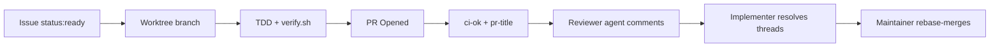

# Contributing to botifil

We use an agent-assisted workflow where human maintainers and autonomous agents collaborate via pull requests.

## Development Lifecycle



## Setup & Verification

Initialize toolchain and run verification:
```bash
mise install
./scripts/verify.sh
```

Maintainers bootstrap labels and repository settings via:
```bash
./scripts/gh-bootstrap.sh
```

## Labels

- `type:*`: `type:feat`, `type:fix`, `type:docs`, `type:chore`, `type:refactor`, `type:test`, `type:perf`.
- `area:*`: `area:bot`, `area:ci`, `area:docs`, `area:agents`.
- `status:*`: `status:needs-spec`, `status:ready`, `status:in-progress`, `status:blocked`, `status:needs-human`.
- `size:*`: `size:S`, `size:M`, `size:L` (PR ceiling: ≤ 300 LoC diff).

## Review & Merge Policy

- PRs require all CI checks (`ci-ok`, `pr-title`) to pass.
- Reviewer agents submit reviews as inline comments without approving.
- All review threads must be resolved before merging.
- Every commit must follow Conventional Commits and stay atomic (rebase-merge preserves all commits).
- Only repository maintainers merge pull requests (`gh pr merge --rebase`).
