# Telegram Join Request Domain Specification

This document details the Telegram Bot API domain mechanics for processing join requests (`ChatJoinRequest`), routing identifiers, authorization lifecycles, and failure modes.

## 1. Interaction Flow

When administrator approval is required, Telegram intercepts join attempts and emits a `chat_join_request` update. Bots with `can_invite_users` permissions use an ephemeral 5-minute direct-messaging window to verify applicants before admitting or rejecting them.

```mermaid
sequenceDiagram
    autonumber
    actor User as Applicant
    participant TG as Telegram Bot API
    participant Bot as Gatekeeper Bot
    participant Group as Target Supergroup / Channel

    User->>TG: Clicks "Request to Join"
    TG->>Bot: Update: chat_join_request
    Note over Bot: Extract from.id (UserId)<br/>and user_chat_id (ChatId)
    rect rgb(32, 44, 58)
        Note over Bot,User: Ephemeral 5-Minute DM Window
        Bot->>TG: sendMessage(chat_id: user_chat_id, text, reply_markup)
        TG->>User: Deliver DM (No /start required)
        User->>TG: Clicks inline button
        TG->>Bot: Update: callback_query (data, from.id)
    end
    alt Verification Successful
        Bot->>TG: approveChatJoinRequest(chat_id: chat.id, user_id: from.id)
        TG->>Group: Add user to chat
        TG->>Bot: Update: chat_member (status: member)
        Bot->>TG: editMessageText(chat_id: user_chat_id, text: "Approved")
    else Verification Failed / Expired
        Bot->>TG: declineChatJoinRequest(chat_id: chat.id, user_id: from.id)
        TG-->>User: Dismiss request silently
        Bot->>TG: editMessageText(chat_id: user_chat_id, text: "Declined")
    end
```

## 2. Routing Identifiers & Type Invariants

The `ChatJoinRequest` payload contains three distinct identifier fields with incompatible semantics:

| Field | Telegram Semantic | Target API Methods | Failure Mode if Swapped |
| :--- | :--- | :--- | :--- |
| `req.chat.id` | Target supergroup or channel identifier (`ChatId`). | `chat_id` in `approveChatJoinRequest`, `declineChatJoinRequest`. | Sending DM to group chat leaks verification to public. |
| `req.from.id` | Global Telegram user account identity (`UserId`). | `user_id` in `approveChatJoinRequest`, `declineChatJoinRequest`. | `403 Forbidden` if used as `chat_id` in `sendMessage` without `/start`. |
| `req.user_chat_id` | Ephemeral 1-on-1 direct message routing target (`ChatId`). | `chat_id` in `sendMessage`, `editMessageText`. | `400 USER_ID_INVALID` if passed as `user_id` to join approval methods. |

### Type Safety via `teloxide`
In `teloxide`, `ChatId` and `UserId` are distinct newtypes (`teloxide::types::ChatId` vs `teloxide::types::UserId`).
- `bot.send_message(req.user_chat_id, ...)` accepts `Recipient::Id(ChatId)`. Passing `UserId` fails at compile time without explicit type conversion.
- `bot.approve_chat_join_request(req.chat.id, req.from.id)` accepts `(ChatId, UserId)`. Swapping argument positions produces a compile-time type error.

## 3. Ephemeral 5-Minute Direct Messaging Window

Telegram strictly forbids unsolicited bot DMs unless an active authorization context exists:

1. **Window Initiation**: Triggered when an applicant submits a join request. Telegram grants the bot a 300-second authorization ticket bound to `user_chat_id`.
2. **No `/start` Prerequisite**: The bot can send initial messages with `InlineKeyboardMarkup` directly to `user_chat_id`.
3. **Window Expiration**: After 300 seconds from `req.date`, outbound messages fail with `403 Forbidden: bot can't initiate conversation with a user`.
4. **Premature Termination**: Calling `approveChatJoinRequest` or `declineChatJoinRequest` terminates the ticket immediately. Any UI edits to the challenge message must be performed prior to or concurrently with the resolution call.
5. **Block Bypass Limit**: If the user has explicitly blocked the bot previously, outbound messages immediately fail with `403 Forbidden: bot was blocked by the user`.

## 4. Chat Configuration & Invite Link Invariants

### Permissions & Activation Modes
- **Administrator Permission**: The bot must hold the `can_invite_users` administrator right in the target chat.
- **Public Supergroups**: Configured under *Chat Settings -> Chat Type -> Approve New Members*. Users joining via public `@username` omit `req.invite_link` (`null`).
- **Private Supergroups / Channels**: Users join via invite links created with `creates_join_request = true`. `req.invite_link` is populated with creator and campaign name metadata.

### Parameter Mutual Exclusivity
When generating invite links via `createChatInviteLink`:
- `creates_join_request = true` is **mutually exclusive** with `member_limit`.
- Combining both parameters causes Telegram to reject the call with `400 Bad Request: MEMBER_LIMIT_INVALID`.

## 5. Update Delivery & Whitelist Rules

Telegram's `getUpdates` and `setWebhook` treat `allowed_updates` as an exclusive whitelist:

| Update Type | Status | Role in Join Request Pipeline |
| :--- | :--- | :--- |
| `chat_join_request` | **Mandatory** | Delivers incoming applicant payload and `user_chat_id`. Dropped if omitted. |
| `callback_query` | **Mandatory** | Receives button clicks from applicant inline keyboards in DM. |
| `chat_member` | **Optional** | Confirms member status transitions (`left` -> `member`) after approval. |

> Omitting `chat_join_request` from `allowed_updates` prevents the bot from receiving join requests entirely, even if administrator permissions are valid.

## 6. Callback Data Constraints

Telegram restricts `InlineKeyboardButton.callback_data` to a strict ceiling of **64 UTF-8 bytes**.
- Signatures, nonce tokens, or state representations embedded directly into callback data must fit within 64 bytes.
- When using cryptographic tokens (e.g., HMAC-SHA256 signatures or session keys), bots must truncate digest payloads or store state in memory and emit short references.

## 7. Error Handling Matrix

The Bot API returns specific error codes during join request processing that require deterministic handling:

| Status | Error Substring | Root Cause | Handling Strategy |
| :--- | :--- | :--- | :--- |
| `400` | `HIDE_REQUESTER_MISSING` | Request already approved/declined by another admin, or canceled by user. | **Idempotent No-Op**: Evict local session, terminate handler cleanly. |
| `400` | `USER_ALREADY_PARTICIPANT` | User entered via alternative link or direct admin addition. | **Idempotent Success**: Evict session, log success. |
| `400` | `CHAT_ADMIN_REQUIRED` / `RIGHTS_INSUFFICIENT` | Bot lacks `can_invite_users` permission. | **Fatal**: Alert operator for permission reassignment. |
| `400` | `USER_ID_INVALID` | Invalid ID passed (e.g., group `ChatId` passed instead of `UserId`). | **Bug**: Correct identifier mapping in call site. |
| `403` | `bot was blocked by the user` (`USER_IS_BLOCKED`) | User has active block against bot account. | **Non-Fatal Policy**: Decline request or flag for human review. |
| `403` | `bot can't initiate conversation with a user` | 5-minute DM window elapsed or `from.id` routed to DM. | **Session Expired**: Cease DM attempts; decline request or drop. |
| `429` | `Too Many Requests: retry after X` | Group admin rate limit or outbound DM rate limit hit. | **Backoff**: Sleep for duration specified in `parameters.retry_after`. |

## 8. Rate Limits & Throttling Requirements

Telegram enforces granular outbound rate limits:
- **Chat Administrative Operations**: Approximately 20–30 administrative calls per minute per chat.
- **Broadcast Outbound DMs**: Approximately 30 messages per second across distinct chats.

Bots must apply token-bucket rate limiting (such as `teloxide::adaptors::Throttle`) around API clients to queue calls and respect `retry_after` windows automatically.

## 9. Guard Inspection Features (Bot API 10.1+)

Modern Bot API releases provide synchronous applicant profile attributes within `ChatJoinRequest`:

- **Applicant Bio Screening (`req.bio`)**: Profile bio text (up to 70 characters) captured at submission time. Can be evaluated synchronously via regex for scam patterns, channel promotions, or prohibited links before sending a DM.
- **Telegram Premium Detection (`req.from.is_premium`)**: Boolean indicator enabling tiered verification difficulty or fast-path routing.
- **In-Flight Hold**: Requests remain in Telegram's pending queue until explicit resolution or timeout, shielding group membership from automated join raids.
