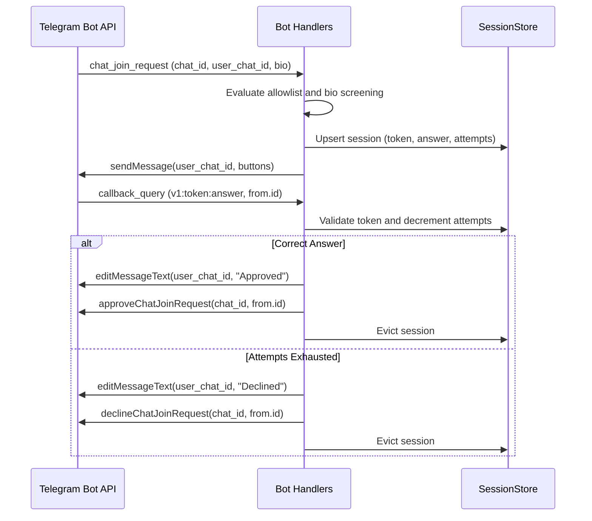

# Plan: Join Request Gatekeeper

- Status: draft
- Spec: [spec.md](./spec.md)

## Architecture & Component Design

The bot follows a modular, layer-separated structure:

- `src/domain.rs`: Newtypes (`SessionToken`), challenge models, and callback payload codec.
- `src/error.rs`: Domain errors and Telegram 7-row Bot API error classification mapping.
- `src/config.rs`: Environment configuration (`BOTIFIL_ALLOWED_CHATS`, `BOTIFIL_CHALLENGE_TTL_SECS`, `BOTIFIL_MAX_ATTEMPTS`).
- `src/store.rs`: Thread-safe bounded in-memory session store (`tokio::sync::RwLock`) with background TTL eviction reaper.
- `src/screening.rs`: Synchronous applicant bio inspection (`req.bio`) evaluating regex scam/spam patterns.
- `src/handlers/mod.rs`: Dispatcher handler tree setup.
- `src/handlers/join_request.rs`: Receives `chat_join_request`, evaluates allowlist/bio, stores session, sends DM challenge.
- `src/handlers/callback.rs`: Receives `callback_query`, decodes payload, validates user, checks answer, edits DM, resolves join.
- `src/lib.rs`: Library exports and shared application state.
- `src/main.rs`: Entry point initializing bot with `teloxide::adaptors::Throttle`, logging, store reaper, and dispatcher.

## Sequence & Flow

## Risk Analysis & Failure Modes

- **Rate Limiting**: Outbound calls wrapped with `teloxide::adaptors::Throttle` to respect Bot API rate limits and backoff automatically.
- **7-Row Bot API Errors**:
  - `400 HIDE_REQUESTER_MISSING`: Idempotent no-op; evict local session.
  - `400 USER_ALREADY_PARTICIPANT`: Idempotent success; evict local session.
  - `400 CHAT_ADMIN_REQUIRED` / `RIGHTS_INSUFFICIENT`: Fatal error; alert operator.
  - `400 USER_ID_INVALID`: Program bug; enforce strong typing (`ChatId` vs `UserId`).
  - `403 USER_IS_BLOCKED`: Non-fatal; evict session and leave pending for manual review.
  - `403 bot can't initiate conversation`: DM window expired or blocked; evict session and leave pending.
  - `429 retry_after`: Throttling backoff applied automatically by `Throttle` adaptor.
- **Memory Growth**: Bounded session capacity and background reaper task preventing leaks from uncompleted challenges.

## Implementation Phases

- Phase 1: Domain types, callback codec, and error classifier.
- Phase 2: Configuration and in-memory TTL store.
- Phase 3: Handlers, throttling, and E2E WireMock verification.
- Phase 4: Bio screening pre-filter and operational documentation.
