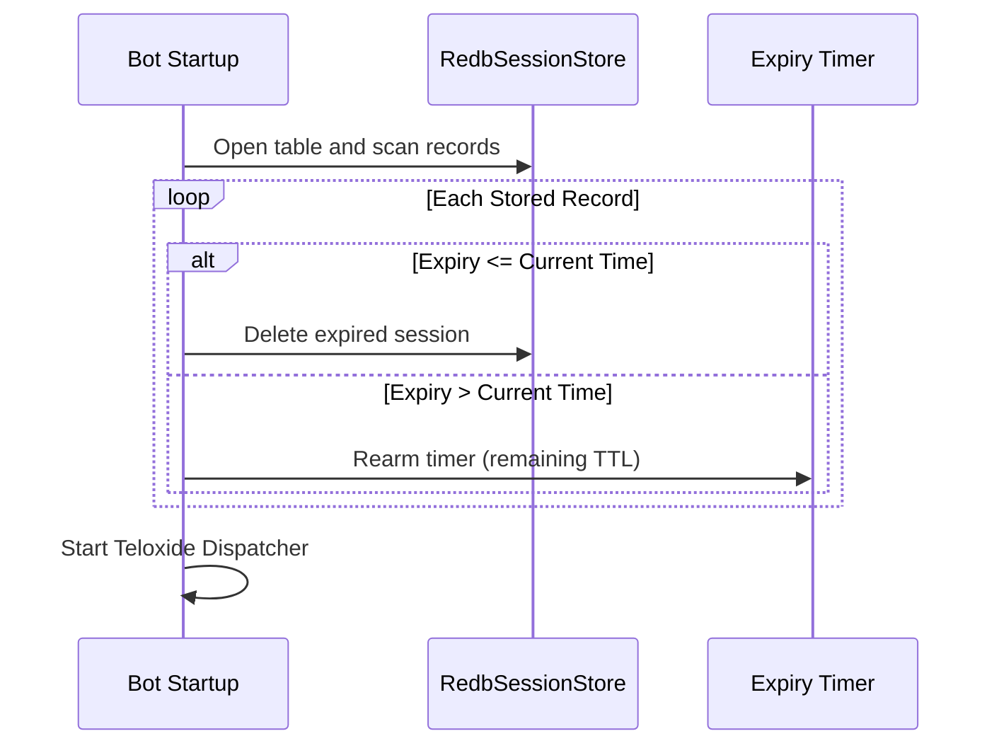

# Plan: Persistence and Admin Controls

- Status: draft
- Spec: [spec.md](./spec.md)

## Architecture & Component Design

The persistence and deployment architecture comprises:

- `src/store/mod.rs`: `Storage` trait defining CRUD operations for `PendingJoin` sessions.
- `src/store/memory.rs`: Existing in-memory store adapted to implement `Storage`.
- `src/store/redb.rs`: `RedbSessionStore` implementing `Storage` using pure-Rust `redb`.
- `src/store/reconciliation.rs`: Startup routine scanning stored records, discarding expired entries, and rearming active timers.
- `Containerfile`: Multi-stage build (`planner` -> `builder` with `cargo-chef` -> `distroless:nonroot` runtime).
- `.dockerignore`: Exclusion list ensuring clean build contexts (excluding `.git`, target, and `.worktrees`).

## Storage Lifecycle & Data Flow

## Security & Container Hardening

- **Static Musl**: Zero shared dynamic libraries (`libc.so`) required at runtime.
- **Distroless**: No package managers, shells, or debugging utilities in the final container image.
- **Non-Root Execution**: Runs as unprivileged `nonroot` (UID 65532).
- **Filesystem Permissions**: Volume mount at `/data` with restricted ownership for persistent storage.

## Implementation Phases

- Phase 1: `Storage` trait abstraction and `RedbSessionStore` implementation.
- Phase 2: Startup reconciliation pass and TTL recovery integration.
- Phase 3: `Containerfile` multi-stage recipe with `cargo-chef` and static musl build.
- Phase 4: Podman deployment scripts, local volume mounting, and documentation.
