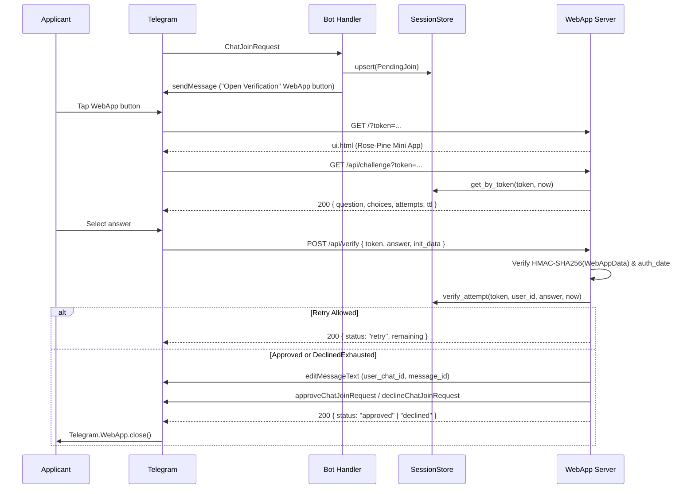

# Plan: Telegram Web App Verification UI

- Status: approved
- Spec: [spec.md](./spec.md)

## Architecture & Component Design

| Component | Responsibility |
| --- | --- |
| `src/config.rs` | Parse/validate `BOTIFIL_WEBAPP_URL` (`https://` or `http://` on `localhost`/`127.0.0.1`) and `BOTIFIL_WEBAPP_BIND` (default `127.0.0.1:8080`). |
| `src/store/` | Add non-mutating `Storage::get_by_token` across `mod.rs`, `memory.rs`, and `redb.rs`, plus `SessionStore::get_by_token` async bridge. |
| `src/webapp/mod.rs` | Export WebApp module, shared `WebAppState` (`bot`, `config`, `store`), and shared join-resolution helper. |
| `src/webapp/auth.rs` | Pure-Rust `WebAppData` HMAC-SHA256 verifier parsing `initData`, checking constant-time signature, `now - auth_date <= challenge_ttl_secs`, and extracting `UserId`. |
| `src/webapp/server.rs` | HTTP router (`GET /`, `GET /api/challenge`, `POST /api/verify`) with graceful `watch::Receiver<bool>` shutdown. |
| `src/webapp/ui.html` | Self-contained Rose-Pine HTML/CSS/JS Mini App embedded via `include_str!("ui.html")` (`Telegram.WebApp` integration). |
| `src/handlers/join_request.rs` | Emit `InlineKeyboardButton::web_app("🛡️ Open Verification", ...)` when `BOTIFIL_WEBAPP_URL` is set; fall back to `build_challenge_keyboard` otherwise. |
| `src/handlers/callback.rs` | Reuse shared DM-edit-before-approve/decline resolution helper so callback and WebApp paths share identical Bot API ordering and error idempotency. |
| `src/main.rs` | Spawn WebApp server alongside `run_expiry_reaper` and `Dispatcher` when `BOTIFIL_WEBAPP_URL` is configured, awaiting shutdown drain. |

## Sequence & Flow

## Security Hardening

- **Signature & Replay Defense**: Reject malformed `initData`, non-matching constant-time HMAC-SHA256 digests, future `auth_date`, or `now - auth_date > challenge_ttl_secs`; enforce `PendingJoin.user_id == verified_user_id`.
- **Least-Data Exposure**: API responses exclude `chat_id`, `user_id`, and `telegram_token`; `Config::Debug` continues redacting secrets and internal IDs.
- **XSS & Payload Bounds**: Validate `SessionToken` (`1..=32` ASCII alphanumeric) before storage lookup, bound request body sizes, and render dynamic values in `ui.html` via `textContent`.
- **Immutable Runtime Footprint**: Compile-time `include_str!("ui.html")` requires zero disk reads/writes, preserving read-only distroless rootfs and `--cap-drop=ALL`.

## Implementation Phases

- **Phase 1**: Configuration options (`BOTIFIL_WEBAPP_URL`, `BOTIFIL_WEBAPP_BIND`) and non-mutating `Storage::get_by_token`.
- **Phase 2**: Pure-Rust `WebAppData` HMAC-SHA256 authenticator (`src/webapp/auth.rs`).
- **Phase 3**: Embedded Rose-Pine Mini App (`src/webapp/ui.html`), HTTP endpoints (`src/webapp/server.rs`), and shared resolution helper.
- **Phase 4**: Join-request WebApp button dispatch, `main.rs` server lifecycle wiring, and `wiremock` E2E verification.
