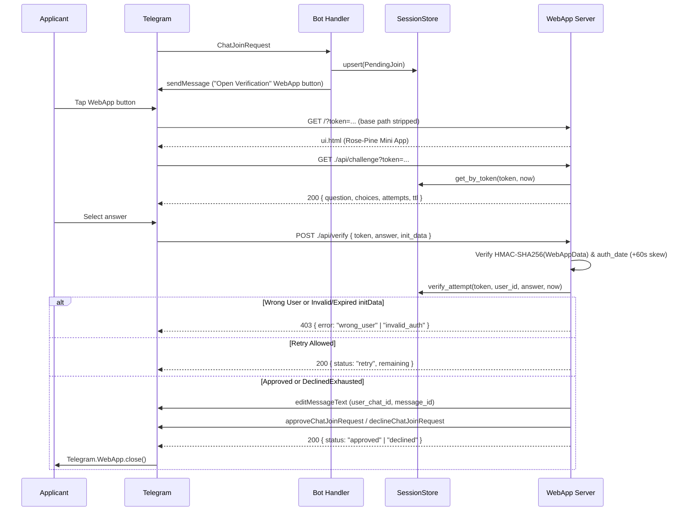

# Plan: Telegram Web App Verification UI

- Status: draft
- Spec: [spec.md](./spec.md)

## Architecture & Component Design

| Component | Responsibility |
| --- | --- |
| `src/config/mod.rs`, `src/config/tests.rs` | Split from `src/config.rs` (275 lines) to stay `<= 300` lines; parse/validate `BOTIFIL_WEBAPP_URL` (`https://`, or `http://` on `localhost`/`127.0.0.1`/`[::1]`) and `BOTIFIL_WEBAPP_BIND` (default `127.0.0.1:8080`), preserving `BOTIFIL_DB_PATH`. |
| `src/store/` | Add non-mutating `Storage::get_by_token` and `SessionStore::get_by_token` across `mod.rs`, `memory.rs` (split tests if needed to stay `<= 300` lines), and `redb.rs` (`begin_read()` for unexpired reads; write tx only for lazy eviction). |
| `src/webapp/mod.rs` | Export WebApp module, shared `WebAppState` (`bot`, `config`, `store`), and shared join-resolution helper. |
| `src/webapp/auth.rs` | Pure-Rust `WebAppData` HMAC-SHA256 verifier parsing `initData`, checking constant-time signature, `now.saturating_sub(auth_date) <= challenge_ttl_secs` with `auth_date <= now + 60`, and extracting `UserId`. |
| `src/webapp/server.rs` | HTTP/1.1 router (`GET /`, `GET /api/challenge`, `POST /api/verify`) stripping configured `BOTIFIL_WEBAPP_URL` base path, rejecting `chunked` / duplicate `Content-Length` (`400`), enforcing read timeouts (`408`), `EMFILE` accept backoff, and `watch::Receiver<bool>` shutdown. |
| `src/webapp/ui.html` | Self-contained Rose-Pine HTML/CSS/JS Mini App (`include_str!("ui.html")`) calling relative `./api/challenge` and `./api/verify`, and rendering distinct `403` messages for `wrong_user` vs `invalid_auth`. |
| `src/handlers/join_request.rs` | Emit `InlineKeyboardButton::web_app("🛡️ Open Verification", ...)` when `BOTIFIL_WEBAPP_URL` is set; fall back to `build_challenge_keyboard` otherwise; preserve `StoreError::Backend` handling. |
| `src/handlers/callback.rs` | Reuse shared DM-edit-before-approve/decline resolution helper so callback and WebApp paths share identical Bot API ordering and error idempotency. |
| `src/main.rs` | Preserve `SessionStore::open_redb` and `reconcile_on_startup`; spawn/drain WebApp server alongside `run_expiry_reaper` and `Dispatcher` when `BOTIFIL_WEBAPP_URL` is set. |

## Sequence & Flow

## Security Hardening

- **Signature & Replay Defense**: Reject malformed `initData`, non-matching constant-time HMAC-SHA256 digests, `auth_date > now + 60`, or `now.saturating_sub(auth_date) > challenge_ttl_secs`; distinguish `wrong_user` (`PendingJoin.user_id != verified_user_id`) from `invalid_auth` in `403` payloads.
- **HTTP Boundary Hardening**: Reject `Transfer-Encoding: chunked` and duplicate `Content-Length` with `400`, bound header/body sizes, return `408` on slowloris/read timeouts, and back off on `EMFILE`/`ENFILE` accept errors.
- **Least-Data Exposure & XSS**: Exclude `chat_id`, `user_id`, and `telegram_token` from API responses; validate `SessionToken` (`1..=32` ASCII alphanumeric) before storage lookup; render dynamic values in `ui.html` via `textContent`.
- **Immutable Runtime Footprint**: Compile-time `include_str!("ui.html")` requires zero disk reads/writes, preserving read-only distroless rootfs and `--cap-drop=ALL`.

## Implementation Phases

- **Phase 1 (M5-1, M5-2)**: WebApp config + dependency promotion (`src/config/` split) and non-mutating `Storage::get_by_token` (`redb` `begin_read()`).
- **Phase 2 (M5-3)**: Pure-Rust `WebAppData` HMAC-SHA256 authenticator (`src/webapp/auth.rs`).
- **Phase 3 (M5-4, M5-5)**: Embedded Rose-Pine Mini App (`src/webapp/ui.html`), HTTP/1.1 server (`src/webapp/server.rs`), and shared DM resolution helper.
- **Phase 4 (M5-6, M5-7)**: Join-request WebApp button dispatch, `main.rs` startup/shutdown wiring, and `tests/webapp_e2e.rs` `wiremock` suite.
